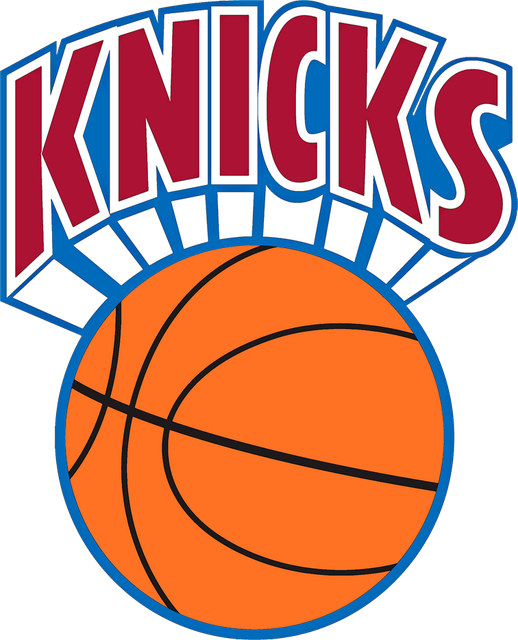

<div align="center">



# Knicks Stats

**An interactive dashboard for the Knicks' 2026–27 season.**<br>
Player cards, league comparisons, standings, and playoff, title and MVP odds simulated live in your browser.

[**Live demo**](https://thinhphucnguyen.github.io/Knicks-Stats/) &nbsp;·&nbsp; [Run locally](#run-it-locally) &nbsp;·&nbsp; [How the odds work](#how-the-odds-work)


<br>


</div>

<br>

## Features

| | |
|---|---|
| **Season outlook** | Playoff, conference and title odds from a 20,000-season Monte Carlo simulation that runs in about a second. Flip the "win / lose at IND" switch and watch the odds move. |
| **Roster tiles** | Every player as an equal, clickable tile with jersey number and points per game. |
| **Player cards** | Radar profile, shooting gauges, scoring mix, and extra per-game numbers for each player. |
| **Leaders** | Animated leaderboard that re-sorts by any stat, with qualification minimums for percentages. |
| **Knicks vs. the league** | How Brunson and Towns rank against the league's top scorers in points, rebounds, assists and more. |
| **MVP race** | A transparent model estimate that updates with the simulation. |
| **Standings** | East and West tables with each team's playoff and title odds filled in. |
| **CSV downloads** | Standings and odds, Knicks player stats, and league leaders with the MVP model. |
| **Efficiency** | Scatter of shot volume against true shooting, plus where the team's points come from. |

Keyboard: <kbd>←</kbd> <kbd>→</kbd> cycles through players.

## Run it locally

No install needed.

```bash
git clone https://github.com/thinhphucnguyen/Knicks-Stats.git
cd Knicks-Stats
python3 -m http.server 8000
```

Then open <http://localhost:8000>. Opening `index.html` directly also works.

## How the odds work

1. **Team strength.** Each team's points margin per game, pulled toward zero because ten games is a small sample.
2. **Schedule.** The rest of every team's 82 games is played against random opponents, with a small home-court edge.
3. **Postseason.** Teams are seeded, the play-in is played, then four best-of-7 rounds.
4. **Repeat.** 20,000 simulated seasons, counted up.

The **MVP estimate** combines a player's production (points, rebounds, assists, steals, blocks, turnovers),
his team's projected wins from the simulation, and games played.

> These are estimates for fun, not betting odds. The model ignores rosters, injuries and the real remaining schedule.

## Project structure

```
index.html   page markup
style.css    design
app.js       interface: tiles, charts, tables, downloads
sim.js       season simulator and MVP model (also runs in Node)
data.js      Knicks players and jersey numbers
league.js    all 30 teams and the league's top 43 scorers
assets/      logo and favicon
docs/        demo GIF
```

## Data

A snapshot from ESPN, taken Nov 13, 2026. ESPN's standings table lags its player table by a game or two for
some teams, and the Knicks record is set to 6–5 to match their team page. To refresh, edit `data.js` and `league.js`.

League comparisons use the league's 43 top scorers, so rebound and assist ranks only count those players.

## Credits

Stats from [ESPN](https://www.espn.com/nba/). Team name and logo belong to the New York Knicks and the NBA.
This is an unofficial fan project.
