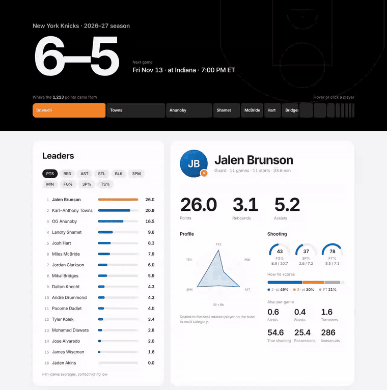

# Knicks Stats

**[Live demo](https://thinhphucnguyen.github.io/Knicks-Stats/)**

Interactive look at the Knicks' 2026-27 season: animated leaderboard, player cards
(radar, shooting gauges, scoring mix) and a volume-vs-efficiency scatter.
Plain HTML, CSS and JS. No build step, no dependencies.

## Run it locally

    python3 -m http.server 8000

then open http://localhost:8000 (or just open `index.html` directly).

## Using it

- Click a stat chip (PTS, REB, AST, ...) and the leaderboard re-sorts.
- Click any player: bar, strip segment or dot. Left/right arrow keys cycle through the roster.
- Hover the scatter dots and the points strip for details.

## Data

`data.js` holds a snapshot of ESPN's team stats page (Nov 13, 2026, 6-5 record).
To refresh, edit the rows and the record at the top of that file.
